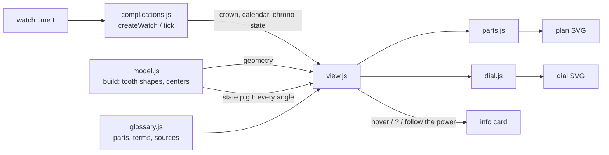

# How Calibre Bench is built

A static site: one HTML page, CSS and six classic script files, no framework, no bundler, no runtime
dependencies. The drawing is SVG, generated in the browser from a geometric model of the movement. About
3,500 lines of app code (`js/`) and 1,300 of tests.

## Runtime

| Piece | What it uses |
|---|---|
| Drawing | **SVG**, built with `document.createElementNS`; pan and zoom by rewriting the `viewBox` |
| Animation | `requestAnimationFrame`; one clock (the watch's time) advanced by the going train |
| Model | Plain JavaScript in UMD-style wrappers, so the same files load in the page and in Node tests |
| Preference | `localStorage` for one display preference (the dial face size) |
| Libraries | None at runtime |

Dev only: Node's built-in test runner (unit tests), Playwright + axe-core (browser and accessibility tests),
a mutation-test script.

## Files

```
index.html          the bench: plan drawing, dial, controls, info card, notes and sources
help.html           the guide; its pictures (help/) are drawn by the app and fingerprinted by the tests
css/style.css       all styling
js/
  model.js          pure geometry and kinematics: tooth shapes, the train, escapement contact, balance timing
  complications.js  pure: the watch as a state machine (crown, winding, setting, calendars, GMT, moon,
                    chronograph, automatic winding, power reserve) and the geometry for each zone
  glossary.js       every part and term explained in two layers, with 53 sources and a marker on each statement
  view.js           draws the model into the SVG, wires up controls, tooltips and the drill-down card
  parts.js          drawing for the complication parts (levers, cams, calendar wheels, chronograph)
  dial.js           the dial: laid out for the chosen features, hands driven by the watch
tests/
  model.test.js     unit tests (Node's test runner) behind every "worked out" claim
  mutants.js        breaks the app 64 ways, one at a time, and fails if a test doesn't notice
e2e/                Playwright: app flows, help-page claims, picture fingerprints, smoke, axe
```

`model.js`, `complications.js` and `glossary.js` don't touch the DOM; they load as `window.Calibre*` in the
page and through `module.exports` in Node.

## How it fits together



Every angle on the drawing comes from one number, the watch's time. Each frame, `view.js` advances the watch
by real elapsed time × the speed setting (`W.tick`), asks the model for every wheel's angle and redraws the
transforms; geometry is rebuilt only when tooth counts, modules or features change.

## Core techniques

- **Tooth shapes.** Wheels have cycloidal tips (epicycloids rolled by a circle half the mating pinion's radius)
  and pinions have radial flanks, generated as outlines from tooth count and module (`gearOutline`,
  `wheelShape`, `pinionShape`). Center distances follow from the modules; each mesh is phased so teeth
  interleave (`meshDrivenFromDriver`).
- **Escapement contact, solved geometrically.** The escape wheel's position isn't scripted. For each lever
  angle, `traceBeat` finds how far the mainspring can push the wheel before a tooth would overlap a pallet
  stone (polygon overlap tests, then bisection), traced once per beat direction and interpolated at runtime
  (`escapeContact`). That's why the wheel recoils slightly as a stone unlocks and never passes through one.
- **Balance and lever.** The balance is a harmonic oscillator at 18,000–36,000 beats an hour; while it's within
  the lift angle its impulse pin drives the lever (`leverFromBalance`), which releases the escape wheel half a
  tooth per beat. Everything upstream turns by exact tooth ratios.
- **Complications as a state machine.** `createWatch` holds crown position, mainspring, calendar,
  chronograph and winding state; time inside the movement only advances through `tick()`, driven by the train.
  Calendars use real month lengths (simple, annual, perpetual via a 48-month cam); the moon phase is set from
  the real date.
- **Every statement is marked.** Glossary text carries `{{source ids}}`, `{{?}}` (citation needed), `{{model}}`
  (a value chosen here), `{{calc}}` (worked out, and checked by a test), `{{app}}` and `{{obs}}` (seen on the
  author's Valjoux 7750). `view.js` turns them into numbered links and labels; a unit test checks every
  citation resolves.

## Testing and deploy

- `npm run test:unit`: Node's test runner on the model: exact train ratios, half a tooth per beat, no tooth
  passing through a stone, date-finger timing, month lengths, crown, chronograph and winding behavior,
  citations.
- `npm run test:e2e`: Playwright at desktop and phone size. `claims.spec.js` turns each claim on the help page
  into a test; `help.spec.js` fingerprints each help picture from exactly what was drawn, so a drawing change
  fails until `npm run help:update` is run and the page is checked by eye. Axe on every page.
- `npm run test:mutants`: 64 deliberate breaks (a moon twice too fast, a misplaced aperture…); each must be
  caught by a claim or unit test.
- Pushing to `main` runs the unit and browser tests in GitHub Actions (the shared workflow in
  [csciuto/app-template](https://github.com/csciuto/app-template)); only if they pass is the site stamped with
  a version and published to GitHub Pages.

## Known limits

- Tooth counts and modules are illustrative, not from a real calibre; the app says so wherever it uses one.
- Plan view only: parts are drawn flat in layers, not in 3D.
- The balance is an ideal oscillator (no positional error, isochronism or temperature effects).
